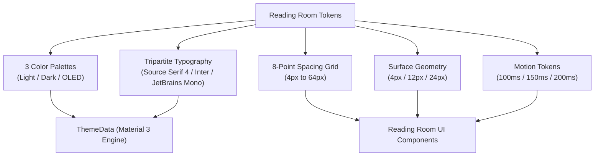
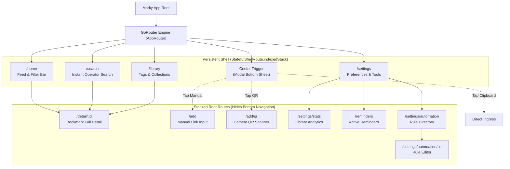
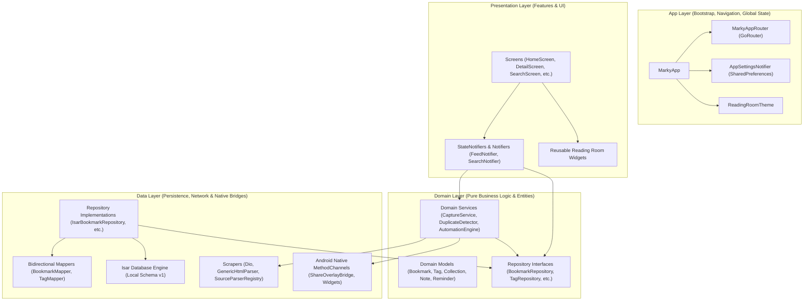
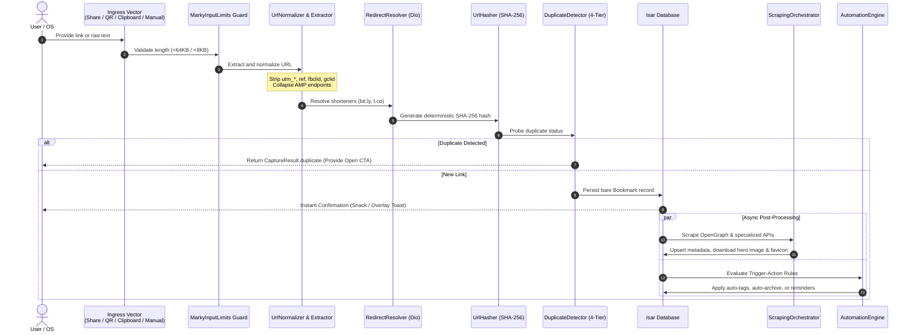

# Marky — Interface & System Design Specification

> **Version:** 1.0.0+1  
> **Status:** Production Reference  
> **Target Platform:** Android (SDK 35/36), Flutter 3.22+, Dart 3.4+  
> **Architecture:** Feature-First Clean Architecture with Riverpod & Isar  
> **Visual Identity:** "Reading Room" (Content-Centric, Flat, OLED-Optimized)

---

## 1. Executive Summary & Design Philosophy

**Marky** is an offline-first personal reading library and link preservation system built natively for Android using Flutter. It is designed around the tenet of **digital sovereignty**: links, tags, annotations, collections, search queries, reminders, and automation rules reside solely on the physical device in an embedded database.

### 1.1 Core Principles

1. **Library Grammar (Calm Technology):** Software should feel like physical print or a quiet private reading room. Visual noise, aggressive animations, drop shadows, and glassmorphic blur effects are avoided. Structure is communicated through typography, flat surfaces, and crisp 1px borders.
2. **Instant Ingress (Zero-Friction Capture):** Saving a link must never interrupt the user's workflow. Marky provides a native transparent Android overlay window (`ShareOverlayActivity`) that captures, normalizes, and enriches links in milliseconds without switching away from the host application.
3. **Deterministic URL Intelligence:** Incoming URLs are sanitized of tracking surveillance vectors, unshortened through redirect resolvers, canonicalized, and checked against a 4-tier duplicate engine before database insertion.
4. **100% Offline-First & Zero Telemetry:** Marky contains no third-party tracker SDKs, analytics beacons, or remote cloud databases. The only network requests issued are client-to-target HTTP calls to scrape page metadata and download favicons/hero media.
5. **Native Android Synergy:** Marky acts as a first-class citizen of Android, utilizing exact alarms, home screen app widgets, quick launcher shortcuts, and biometrics.

---

## 2. Visual & UI Design System: "Reading Room"

The visual language of Marky is codified as the **Reading Room Design System** in `lib/app/theme/reading_room_tokens.dart` and `reading_room_theme.dart`.



### 2.1 Color Palette & Semantic Roles

The design system rejects arbitrary hex codes in feature code. All visual elements bind to semantic tokens across three palette variants:

| Semantic Token | Light Mode | Dark Mode | OLED Pitch Black | Description & Usage |
| :--- | :--- | :--- | :--- | :--- |
| **`surface`** | `#FAFAF7` | `#0E0E0C` | `#000000` | Canvas and scaffold background. Light uses a warm book-page off-white; OLED uses pure `#000000` for pixel shut-off. |
| **`surfaceRaised`** | `#FFFFFF` | `#161614` | `#0A0A0A` | Elevated cards, list row cards, modal sheets, and dialogs. Creates layer hierarchy without shadows. |
| **`ink`** | `#0A0A0A` | `#F5F5F0` | `#F5F5F0` | Primary text and high-emphasis icons. |
| **`muted`** | `#525252` | `#A3A3A0` | `#A3A3A0` | Secondary metadata, relative timestamps, search operators, and disabled states. |
| **`outline`** | `#E7E5E0` | `#2A2A28` | `#1A1A1A` | 1px border stroke for cards, dividers, text inputs, and chips. Replaces elevation shadows. |
| **`accent`** | `#1E3A8A` | `#8AA4DD` | `#8AA4DD` | Restrained classic Ink Blue. Used for primary actions, focused chips, and hyperlinks. |
| **`danger`** | `#9F1239` | `#F87171` | `#F87171` | Destructive actions (deletion, clearing history, error alerts). |

### 2.2 Tripartite Typography System

Marky uses a 3-font typographic hierarchy where each font has a distinct cognitive role:

```text
┌────────────────────────────────────────────────────────────────────────┐
│  Source Serif 4 (Headlines, Article Titles, Literary Voice)            │
│  "The Architecture of Open Knowledge Systems"                         │
├────────────────────────────────────────────────────────────────────────┤
│  Inter (Interface, Navigation, Form Controls, Clean Sans-Serif)        │
│  Save to Collection · Mark as Read · Auto-Tag Rules                   │
├────────────────────────────────────────────────────────────────────────┤
│  JetBrains Mono (Metadata, Timestamps, Domain Names, Data Telemetry)    │
│  github.com · 2h ago · tag:engineering · is:unread                     │
└────────────────────────────────────────────────────────────────────────┘
```

1. **Source Serif 4 (Medium 500):** Headings, screen titles, and bookmark card titles. Evokes the physical intimacy and authority of a printed book.
2. **Inter (Regular 400 & Medium 500):** Body copy, button labels, form inputs, dialog text, and navigation items. Selected for high legibility at micro-sizes on mobile screens.
3. **JetBrains Mono (Regular 400 & Medium 500):** Domain hostnames, relative dates, counters, code snippets, search operator tokens, and metadata tables (`ReadingRoomTextStyles.metadata` and `ReadingRoomTextStyles.monoValue`).

### 2.3 Spatial Scale (8-Point Grid)

All padding, margins, gutters, and layout offsets follow a strict 8-point geometric scale (`ReadingRoomSpacing`):

```text
xs   :  4px  ── Micro gaps between icon and text, status badge padding
sm   :  8px  ── Standard inner spacing, chip horizontal padding, chip run gaps
md   : 12px  ── Card vertical padding, textfield internal spacing
lg   : 16px  ── Screen edge gutter, sheet horizontal margin
xl   : 24px  ── Section headers, between form groups
xxl  : 32px  ── Empty state vertical separation
xxxl : 48px  ── Major module separation
huge : 64px  ── Bottom scroll padding (clearing bottom navigation & FABs)
```

### 2.4 Corner Radii & Elevation Strategy

Marky enforces a **zero-shadow elevation model**. Depth and layer separation are established purely through tonal shifts (`surface` to `surfaceRaised`) and a uniform 1px solid stroke (`outline`).

* **`ReadingRoomRadii.chip` (4px):** Applied to tags, inline source chips, status pills, and small buttons.
* **`ReadingRoomRadii.standard` (12px):** Applied to bookmark cards, input fields, action buttons, and modal dialogs.
* **`ReadingRoomRadii.sheet` (24px):** Applied to top rounded corners of bottom sheets and action panels.

### 2.5 Motion, Accessibility & Ergonomics

* **Durations (`ReadingRoomMotion`):**
  * `instant`: 100ms (selection toggle, icon color shifts)
  * `quick`: 150ms (chip filter selection, small drawer shifts)
  * `standard`: 200ms with `Curves.easeOut` (bottom sheet entrance, modal transitions)
* **Reduced Motion:** If `MediaQuery.disableAnimations` is detected, all transitions snap immediately with zero duration.
* **Accessible Scaling:** Text scaling is supported and certified up to `2.0x`. When large text scaling is detected (`mediaQuery.textScaler.scale(10) > 20`), layout animations automatically disable to prevent rendering thrashing.

---

## 3. Information Architecture & Navigation Model

Marky uses a hybrid navigation structure: persistent primary workflows sit in a bottom navigation shell, while focused, single-purpose workflows stack above the shell.



### 3.1 Persistent Shell Tabs

The navigation shell uses `StatefulShellRoute.indexedStack`. Each tab retains its own independent navigation stack and scroll offset, preventing scroll resets when switching between Home and Library.

1. **Feed (`/home`):**
   * Default landing tab.
   * Displays the bookmarked links as a reactive list or grid.
   * Includes filter chips (`All`, `Unread`, `Favorites`, `Archived`), sort menu (Date Added, Title, Host), layout switch (List vs Grid), and batch selection mode.
   * Includes an intelligent unread reminder nudge banner if links are pending.
2. **Search (`/search`):**
   * Auto-focusing instant search box.
   * Debounced real-time tokenized search with structured operators (`tag:`, `domain:`, `is:`, `before:`, `after:`).
   * Search query history with bookmarking/starring of favorite search queries.
3. **Quick Add (Center Action Button):**
   * Elevated action item in the center of `MarkyBottomNav`.
   * Opens the `QuickAddSheet` with three immediate paths:
     1. **Scan QR:** Launches camera scanner (`mobile_scanner`).
     2. **Manual Input:** Navigates to `/add` text editor.
     3. **Paste Clipboard:** Reads system clipboard, extracts the first valid URL, and triggers instant capture.
4. **Library (`/library`):**
   * Two primary organizational directories:
     * **Tags Grid:** Colored tag chips with usage counts and tag management bottom sheets.
     * **Collections Directory:** Card-based list of manual collections and dynamic Smart Collections.
5. **Settings (`/settings`):**
   * Theme configuration (Light, Dark, OLED pitch-black).
   * Language configuration (English, Turkish, System).
   * Re-engagement and unread reminder schedulers.
   * Automation rules entry.
   * Advanced tools: JSON library export/restore, dashboard statistics, reset to factory defaults.

### 3.2 Stacked Detail Surface (`/detail/:id`)

When a user taps a bookmark card, it pushes `/detail/:id` above the navigation shell, providing an immersive, focused reading view:

* **Hero Sliver App Bar:** Displays high-resolution scraped preview image with interactive fullscreen zoom (`InteractiveViewer`).
* **Title & Domain Row:** Source Serif headline with a dotted domain hyperlink that allows filtering the entire feed by that host in one tap.
* **Inline Content-Type Badge:** Indicates article, video, code repository, social post, or generic web link.
* **10-Action Responsive Toolbar:**
  * `Open` (Launches default external browser)
  * `Copy` (Copies canonical URL to clipboard)
  * `Edit` (Modal dialog to modify title & description)
  * `Refetch` (Re-runs metadata scraping pipeline)
  * `Favorite / Unfav` (Toggles star status)
  * `Archive / Unarchive` (Toggles archive visibility)
  * `Read / Unread` (Toggles read progress)
  * `Pin / Unpin` (Pins bookmark to top of feed)
  * `Share` (Invokes system share sheet via `share_plus`)
  * `Delete` (Confirmation dialog and hard deletion)
* **Metadata Grid:** Scraped author, publication timestamp, save timestamp, site name, open count, last opened timestamp, scraper status.
* **Tag Section:** Colored interactive chips with inline remove and modal add.
* **Collection Section:** Folder badges indicating collection memberships.
* **Notes Timeline:** Chronological, multi-note annotation feed with timestamped additions and inline editing.
* **Reminders List:** Notification schedule tiles with cancel/reschedule actions.

---

## 4. UI Components & Layout Anatomy

### 4.1 Bookmark Card Anatomy (`lib/features/home/presentation/widgets/bookmark_card.dart`)

```text
┌────────────────────────────────────────────────────────────────────────┐
│ [ ]  ┌──────────┐  How SQLite Database Engine Works Internally        │
│ (1)  │          │  fly.io · 3 hours ago · (Article)                   │
│      │  [Hero]  │  ♥ Pinned · [database] [sqlite]                      │
│      │          │                                                      │
│      └──────────┘                                                      │
└────────────────────────────────────────────────────────────────────────┘
```

1. **Selection Radio/Checkbox (1):** Only appears when `selectionMode` is active.
2. **Visual Thumbnail (2):**
   * Tier 1: Local cached hero image (`CachedNetworkImage` / local disk file).
   * Tier 2: Domain favicon.
   * Tier 3: High-contrast typography monogram derived from host tokens (e.g., `FL` for `fly.io`).
3. **Text Stack (3):**
   * Title clamped to 2 lines max with `TextOverflow.ellipsis` in `Inter` medium.
   * Subtitle row: host domain and relative timestamp (`timeago`) in `JetBrains Mono` muted.
   * Status badge row: Heart icon (favorite), pin icon (pinned), checkmark (read).
   * Dynamic tag chip row: Horizontal mini chips colored according to tag ARGB swatch.

### 4.2 Batch Action Bar (`lib/features/home/presentation/widgets/batch_action_bar.dart`)

Activating selection mode (via long-press on any card or tapping select all) pins a sticky toolbar to the bottom of the screen:

* **Live Counter:** Header displays the active selected count (e.g., `5 selected`).
* **Select All Action:** Fast toggle to select all bookmarks in the current filter.
* **Batch Operations:**
  * **Archive:** Toggles archive state for all selected items.
  * **Favorite:** Toggles favorite state across the selection.
  * **Read:** Marks selection as read and triggers unread notification resync.
  * **Delete:** Prompts a single destructive confirmation dialog and executes an atomic multi-item delete.

### 4.3 Error Boundaries & PII Suppression

Technical safety is guaranteed through `MarkyErrorBoundary` and `safe_error_details.dart`. If an unexpected widget assertion or database failure occurs:
* The user sees an elegant `MarkyErrorState` with a human-readable title and localized recovery actions.
* Technical stack traces, file system paths, and raw URL strings are strictly suppressed in release builds (`kReleaseMode`), safeguarding user privacy.

---

## 5. System Architecture & Layering

Marky follows **Feature-First Clean Architecture**, ensuring strict separation of concerns, testability, and zero circular dependencies.



### 5.1 Layer Responsibilities

1. **`lib/app/`:**
   * Global configuration, routing tables (`routes.dart`), theme generation, and user settings storage.
   * `MarkyApp` handles lifecycle events (`WidgetsBindingObserver`), cold-start share intents, quick launcher action routing, and notification click routing.
2. **`lib/core/`:**
   * Framework-agnostic infrastructure.
   * `database/`: Database singleton open, migration contracts, and schema definitions.
   * `input/`: Global bounding limits (max URL 8192 chars, max shared text 65536 chars).
   * `notifications/`: Wrapper around `flutter_local_notifications` for exact alarms and background scheduling.
   * `scraping/`: HTTP client (`Dio`), HTML parser (`html`), and platform scrapers.
   * `url/`: URL sanitation, tracking parameter stripper, redirect resolver, and SHA-256 hasher.
3. **`lib/features/`:**
   * Self-contained domain modules divided into `data/`, `domain/`, and `presentation/`:
   * `add/`, `automation/`, `backup/`, `bookmarks/`, `capture/`, `collections/`, `dashboard/`, `detail/`, `home/`, `import_export/`, `library/`, `notes/`, `onboarding/`, `quick_actions/`, `reminders/`, `search/`, `settings/`, `share_intent/`, `tags/`, `widgets/`.
4. **`lib/shared/`:**
   * Shared, cross-cutting UI components that adhere strictly to Reading Room design tokens.

---

## 6. Data & Persistence Layer (Isar v1)

Persistence is governed by the embedded, high-performance [Isar Database](file:///lib/core/database/marky_database.dart).

### 6.1 Database Catalog & Schemas

The database operates under **Schema Version 1**:

| Collection | Entity Class | Primary Responsibility | Key Indexed Fields |
| :--- | :--- | :--- | :--- |
| **`bookmarks`** | `BookmarkEntity` | Core link records, scraped metadata, status flags, and relational ID arrays. | `canonicalUrl`, `normalizedHost`, `urlHash`, `externalContentId`, `createdAt` |
| **`tags`** | `TagEntity` | User-defined categorization tags with custom ARGB swatches and icon glyphs. | `slug`, `name`, `usageCount` |
| **`collections`** | `CollectionEntity` | Container groupings supporting manual bookmark assignment and smart query rules. | `title`, `isSmart`, `sortOrder` |
| **`notes`** | `NoteEntity` | Per-bookmark timestamped annotations with markdown/plain text. | `bookmarkId`, `createdAt` |
| **`reminders`** | `ReminderEntity` | Scheduled alarm metadata linked to specific bookmarks. | `bookmarkId`, `targetTime`, `status` |
| **`search_queries`**| `SearchQueryEntity`| Search term history and pinned/favorite searches. | `rawQuery`, `lastUsedAt`, `isSaved` |
| **`automation_rules`**| `AutomationRuleEntity`| Trigger-action definitions for post-capture automation. | `isEnabled`, `priority` |
| **`backup_meta`** | `BackupMetaEntity` | Export timestamps, item count, and JSON payload checksums. | `createdAt` |

### 6.2 Data Model Decoupling & Invariant Mappers

* To prevent ORM leak into business logic, UI and domain code never reference `*Entity` classes.
* Bidirectional mappers (`BookmarkMapper`, `TagMapper`, `NoteMapper`, etc.) strictly translate between mutable Isar entities and immutable domain models (`Bookmark`, `Tag`, `Note`).
* Hard deletion is used rather than soft-deletion tombstones; session-level undo is handled in memory via temporary snackbar caches.

---

## 7. Capture & URL Intelligence Pipeline

The ingestion pipeline handles raw text from any source and converts it into a clean, canonical bookmark:



### 7.1 URL Hygiene & Sanitization
* **Tracking Stripper:** Removes surveillance telemetry parameters including `utm_source`, `utm_medium`, `utm_campaign`, `utm_term`, `utm_content`, `ref`, `fbclid`, `gclid`, `mc_eid`, `si`, `igshid`.
* **AMP Unrolling:** Automatically strips `/amp/` paths and subdomain prefixes, resolving links to the canonical source article.
* **Shortener Resolution:** Recognizes URL shorteners (`t.co`, `bit.ly`, `tinyurl.com`, `goo.gl`, etc.) and performs a lightweight `HEAD`/`GET` redirect trace before deduplication and storage.

### 7.2 The 4-Tier Duplicate Detection Engine

Duplicate detection checks 4 independent dimensions to avoid library clutter:
1. **Canonical URL Match:** Exact string match against normalized canonical URL.
2. **URL Hash Match:** Cryptographic SHA-256 hash match against `urlHash` index.
3. **Domain + Path Heuristic:** Matches the origin domain and path while disregarding superficial trailing parameters.
4. **External Content ID:** Extracts platform-specific unique entity IDs (e.g., YouTube video ID `v=...`, Reddit post ID, GitHub owner/repo). This guarantees that a mobile YouTube link (`youtu.be/xyz`) collapses against a desktop link (`youtube.com/watch?v=xyz`).

---

## 8. Metadata Scraping Engine & Source Parsers

Scraping is coordinated by `MetadataScraperService` utilizing a modular `SourceParserRegistry`:

```text
Incoming Scrape Task (URL)
          │
          ├──► Specialized Platform Parser?
          │         ├─► YouTubeParser: Video ID, channel, maxresdefault thumbnail
          │         ├─► RedditParser : /r/.../comments/...json public endpoint fallback
          │         ├─► GitHubParser : Repo metadata, star count, owner avatar
          │         └─► TwitterParser: Status text, author handle, card image
          │
          ├──► GenericHtmlParser (Always runs in parallel / fallback)
          │         ├─► Extracts OpenGraph: og:title, og:image, og:description
          │         ├─► Extracts Twitter Cards & HTML meta tags
          │         └─► Anti-Bot Shield: Filters out Cloudflare challenge & captcha interstitial text
          │
          └──► Merge: Specialized wins; Generic fills missing fields
                    │
                    ├──► Download hero image -> <appDir>/thumbnails/<sha1>.ext
                    └──► Download domain favicon -> <appDir>/favicons/<sha1>.ext
```

### 8.1 Visual Fallback Cascade
When rendering a bookmark, the UI evaluates visual assets in strict order:
1. **Cached Local Hero Image:** High-resolution image downloaded by `ThumbnailService`.
2. **Cached Local Favicon:** Domain icon downloaded by `FaviconService` (via Google Favicon API fallback).
3. **Dynamic Vector Monogram:** High-contrast letter glyph derived from domain tokens on a deterministic tinted background.

---

## 9. Automation Engine & Smart Organization

### 9.1 Automation Rule Engine (`lib/features/automation/`)

Marky enables in-app automated workflows evaluated immediately after capture:

* **Triggers (`AutomationTriggerType`):**
  * `domain`: Matches normalized host (e.g., `youtube.com`).
  * `sourceType`: Matches intake method (`manual`, `share`, `clipboard`, `import`).
  * `contentType`: Matches detected type (`article`, `video`, `repository`, `document`).
  * `tag`: Matches tag presence.
* **Trigger Logic:** `ALL` (logical AND) or `ANY` (logical OR) across multiple conditions.
* **Actions (`AutomationActionType`):**
  * `addTag`: Attaches a specific tag.
  * `archive`: Automatically moves to archive.
  * `addToCollection`: Assigns to a specific collection.
  * `scheduleReminder`: Sets an automated reading reminder (e.g., +2 hours).
* **Loop Prevention & Audit Log:**
  * Rules execute sequentially based on priority.
  * Rule actions cannot trigger cascade loops.
  * Every execution is logged to `AutomationDebugLog` for user transparency and debugging.

### 9.2 Smart Collections (`lib/features/collections/domain/`)

In addition to manual collections, Marky supports **Smart Collections**:
* Defined by dynamic criteria (e.g., `filter: unread`, `host: github.com`, `addedWithinDays: 7`).
* Evaluated dynamically by `SmartCollectionEvaluator` on top of feed queries.
* Requires zero database redundancy; bookmarks automatically appear or disappear from the collection as their status changes.

---

## 10. Search & Structured Operator Grammar

Search is managed by `BookmarkSearchService` and `SearchOperatorParser`. Queries execute instantly across local Isar indexes with a 300ms debounce.

```text
Query: "sqlite performance tag:flutter domain:github.com is:unread before:2026-05-01"
         │
         ├── Free Text Tokens     : "sqlite performance"
         ├── Tag Slug Filter      : "flutter"
         ├── Domain Host Filter   : "github.com"
         ├── Status Filter        : unread (isRead == false && isArchived == false)
         └── Date Cutoff Filter   : createdAt <= 2026-05-01T23:59:59
```

Supported Operators:
* `tag:<name>` — Filters by assigned tag slug.
* `domain:<host>` — Filters by normalized host domain.
* `is:favorite` / `is:unread` / `is:read` / `is:archived` — Status filters.
* `before:<YYYY-MM-DD>` — Matches links created before the date.
* `after:<YYYY-MM-DD>` — Matches links created after the date.

---

## 11. Notifications & Re-engagement System

Marky provides reliable reminder scheduling without relying on remote push notification servers.

### 11.1 Scheduling Mechanics
* Built on `flutter_local_notifications` with Android exact alarm permissions (`SCHEDULE_EXACT_ALARM`).
* **Reboot Survival:** The app registers for `RECEIVE_BOOT_COMPLETED`. Upon device restart, `_finishPostLaunchStartup` loads all active reminders from Isar and re-registers them with the Android AlarmManager.

### 11.2 Unread Link Re-Engagement Nudges
* Users can enable periodic nudges for unread bookmarks in settings.
* **Cadence Options:** `daily` or `weekly`.
* Configurable weekday, hour, and minute.
* The scheduler probes the library: if no unread links exist, the notification is silently skipped to avoid user fatigue.

---

## 12. Native Android Integration

Marky deeply integrates with the Android operating system through Kotlin implementations in `android/app/src/main/kotlin/com/marky/app/marky/`:

```text
android/app/src/main/
├── kotlin/com/marky/app/marky/
│   ├── MainActivity.kt                # FlutterFragmentActivity with strict Route Allowlists
│   ├── ShareOverlayActivity.kt        # Transparent, lightweight overlay activity
│   ├── ShareOverlayFlutterHost.kt     # MethodChannel bridge for overlay payload transfer
│   ├── ShareOverlayHost.kt            # Native lifecycle & Flutter engine coordinator
│   └── MarkyFeedWidgetProvider.kt     # AppWidgetProvider for home screen feed widget
└── res/
    ├── layout/marky_feed_widget.xml   # RemoteViews native XML widget layout
    ├── xml/shortcuts.xml              # Static launcher shortcuts (Add, Search, Unread, Reminders)
    └── xml/marky_feed_widget_info.xml # AppWidget configuration metadata
```

### 12.1 Floating Share Overlay (`ShareOverlayActivity`)
* Handles Android's global `ACTION_SEND` and `ACTION_SEND_MULTIPLE` intents.
* Utilizes a transparent window (`Theme.Translucent.NoTitleBar`) and an independent pre-warmed Flutter engine running `ShareOverlayApp`.
* Shows an instant native pulsing feedback indicator while Flutter loads.
* Features native touch drag-to-dismiss: users can swipe the bottom panel down to dismiss immediately.
* Auto-closes after 4 seconds or on user dismissal, never stealing window focus from the sharing application.

### 12.2 Home Screen AppWidget (`MarkyFeedWidgetProvider`)
* Renders a 4x2 Android Home Screen widget displaying:
  * Application header and unread link counter.
  * The 3 latest saved bookmark titles and domains.
* Automatically synchronized whenever a bookmark is captured, updated, or deleted via `WidgetFeedSnapshotService` over `MethodChannel('marky/home_widget')`.
* Tapping the widget opens `MainActivity` directly into `/home`.

### 12.3 Static Launcher Shortcuts (`shortcuts.xml`)
Long-pressing the Marky app icon on Android reveals four static quick routes:
1. **Add Link:** Jumps directly to `/add`.
2. **Search:** Jumps directly to `/search`.
3. **Unread:** Jumps directly to `/home/unread`.
4. **Reminders:** Jumps directly to `/reminders`.

### 12.4 Route Security & Allowlist Enforcement
To protect the app against malicious intent routing or deep link hijacking, `MainActivity.kt` enforces an explicit `OPEN_ROUTE` allowlist:
* Allowed routes: `/home`, `/add`, `/search`, `/home/unread`, `/reminders`.
* Arbitrary external intents cannot force navigation into sensitive screens like Settings or Database Management.

---

## 13. Data Portability: Import & Export

Marky enforces open data ownership with zero vendor lock-in.

### 13.1 Standalone JSON Backup Specification (v1)
The entire library exports into a structured UTF-8 JSON format:

```json
{
  "version": 1,
  "exportedAt": "2026-05-01T12:00:00.000Z",
  "bookmarks": [
    {
      "originalUrl": "https://flutter.dev",
      "canonicalUrl": "https://flutter.dev",
      "urlHash": "e3b0c44298fc1c149afbf4c8996fb92427ae41e4649b934ca495991b7852b855",
      "title": "Flutter - Build apps for any screen",
      "description": "Flutter transforms the frontend development process.",
      "contentType": "article",
      "sourceType": "manual",
      "isFavorite": true,
      "isArchived": false,
      "isRead": false,
      "createdAt": "2026-05-01T10:00:00.000Z",
      "updatedAt": "2026-05-01T10:05:00.000Z"
    }
  ],
  "tags": [
    {
      "name": "Flutter",
      "slug": "flutter",
      "colorArgb": 4280191205
    }
  ],
  "collections": [
    {
      "title": "Mobile Development",
      "isSmart": false,
      "colorArgb": 4280191205
    }
  ]
}
```

### 13.2 Non-Destructive Restore & Duplicate Protection
* During JSON restoration, incoming bookmarks are matched by `urlHash` and `canonicalUrl`.
* If a bookmark already exists locally, the user's existing local notes, read status, and tags are preserved; the item is **merged or skipped**, never overwritten.
* New tags and collections are synthesized and re-linked seamlessly.

---

## 14. Library Analytics & Dashboard Engine

Accessible via `/settings/stats`, the `DashboardScreen` visualizes library health using `fl_chart`:

* **Summary Metrics:** Total Bookmarks, Unread Ratio, Favorite Ratio, Archived Count, and Links Added This Week.
* **Distribution Timelines:** 7-day activity bar chart displaying capture velocity.
* **Source Breakdown:** Proportional breakdown of intake vectors (Manual, Share, Clipboard, Import, Automation).
* **Top Domain Ranking:** Ranked horizontal frequency bars showing the user's most frequented websites.
* **Tag Density:** Distribution of top applied organizational tags.

---

## 15. Security, Privacy & Compliance Architecture

| Security Dimension | Implementation & Guarantee |
| :--- | :--- |
| **Data Storage** | 100% on-device in Isar v1 database. No remote sync, no cloud storage dependency. |
| **Network Egress** | Zero analytics, crash reporting, or telemetry beacons. Outbound HTTP requests are restricted strictly to user-requested link scraping and favicon downloads. |
| **Window Protection** | Android `FLAG_SECURE` capability prevents thumbnail leak in Android's recent app switcher. |
| **Error Sanitization** | `safe_error_details.dart` redacts local file paths, query strings, and stack traces from production UI. |
| **Intent Guard** | Explicit route allowlist in `MainActivity.kt` prevents deep-link routing exploits. |

---

## 16. Technical Stack Summary

| Layer / Concern | Technology & Library Version |
| :--- | :--- |
| **Framework & Language** | Flutter `>=3.22.0`, Dart `>=3.4.0 <4.0.0` |
| **Architecture** | Feature-First Clean Architecture, Unidirectional Data Flow |
| **State Management** | `flutter_riverpod: ^2.6.1`, `hooks_riverpod: ^2.6.1` |
| **Routing & Navigation** | `go_router: ^14.8.1` (`StatefulShellRoute.indexedStack`) |
| **Database & Cache** | `isar: ^3.1.0+1`, `isar_flutter_libs: ^3.1.0+1` |
| **Network & Scraping** | `dio: ^5.8.0+1`, `html: ^0.15.5` |
| **Image Caching** | `cached_network_image: ^3.4.1`, custom `ThumbnailService` |
| **Notifications & Alarms** | `flutter_local_notifications: ^19.0.0`, `timezone: ^0.10.0` |
| **Hardware & Native** | `mobile_scanner: ^6.0.0` (QR) |
| **UI Charts & Graphs** | `fl_chart: ^0.70.0` |
| **Typography** | `google_fonts: ^6.2.1` (Source Serif 4, Inter, JetBrains Mono) |
| **System Sharing** | `share_plus: ^10.1.4`, `receive_sharing_intent: ^1.8.1` |
| **Code Generation** | `build_runner: ^2.4.13`, `isar_generator: ^3.1.0+1` |
