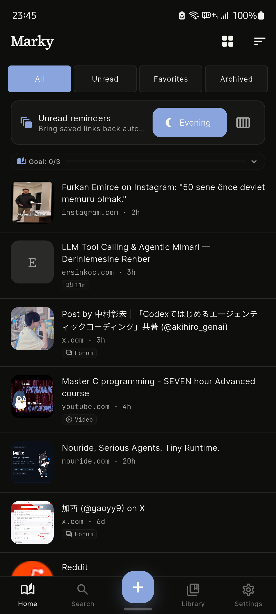
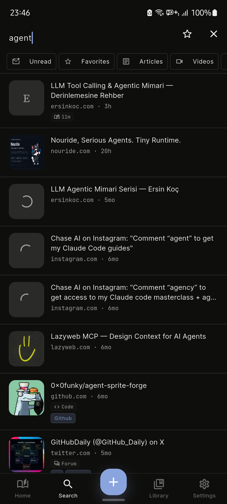
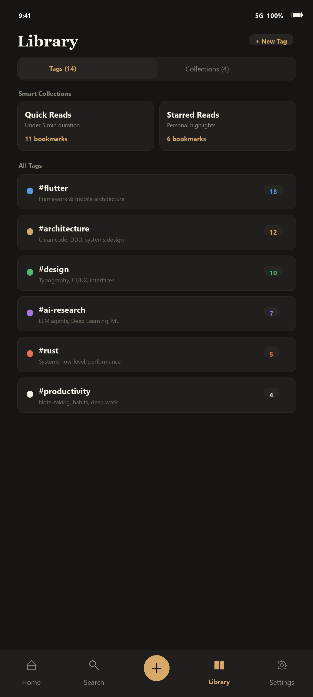
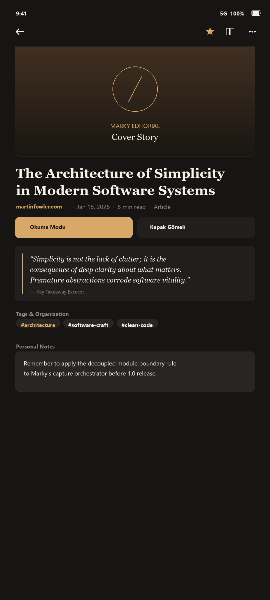
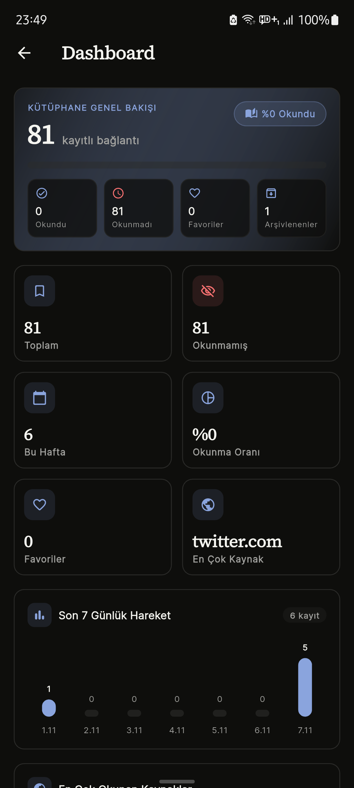
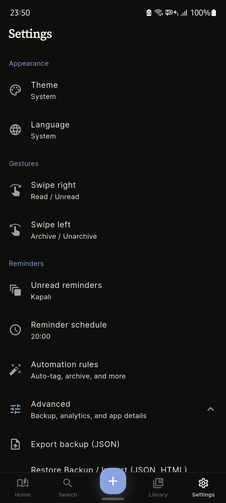

<div align="center">


# Marky

### Save links. Read later. Keep it all on your phone.

An offline-first personal link manager and reading library for Android.
<br>
*Çevrimdışı öncelikli kişisel bağlantı yöneticisi ve okuma kütüphanesi.*

<br>

[](https://github.com/Vyr0-the-dev/marky/releases/latest)

[](https://github.com/Vyr0-the-dev/marky/actions)
[](https://flutter.dev)
[](android)
[](PRIVACY.md)
[](LICENSE)

</div>

---

## Why Marky?

Browsers bury bookmarks, read-later services want an account, and "send to self" chats turn into a graveyard. Marky is a quiet, local library for the links you actually want to come back to:

- **No account, no server.** Everything lives in an on-device Isar database.
- **One tap to save.** Share from any app — a native overlay saves without leaving what you're doing.
- **Built for returning.** Unread queue, reminders, a home screen widget and a distraction-free reader.

---

## 📱 Screenshots

<div align="center">

| Home | Search | Library |
|:---:|:---:|:---:|
|  |  |  |
| **Reader** | **Analytics** | **Settings** |
|  |  |  |

<sub>Screenshots captured directly from the Marky release build on Android.</sub>

</div>

---

## ✨ Features

| | |
|:---|:---|
| ⚡ **Instant capture** | Android share sheet overlay, clipboard detection, manual entry and QR scanning. |
| 🔁 **Smart deduplication** | Canonical URLs, SHA-256 hashes and platform IDs (YouTube, Reddit, GitHub, X) — saving twice just offers *Open*. |
| 🖼️ **Rich metadata** | Titles, descriptions, cover images and favicons fetched automatically. Change or remove any cover image yourself. |
| 📖 **Reader mode** | Clean editorial typography for articles, Reddit threads and X posts. |
| 📂 **Tags & collections** | Colored tags, manual collections and rule-based smart collections. |
| 🔍 **Search operators** | `tag:flutter` `domain:github.com` `source:youtube` `is:favorite` `before:2026-01-01` — plus saved searches. |
| 🤖 **Automations** | Auto-tag, archive or file new links based on domain or source type. |
| ⏰ **Reminders** | Exact-alarm reminders per bookmark and a daily or weekly unread nudge. |
| 🏠 **Home screen widget** | Latest unread links with Quick Add and Search shortcuts. |
| 🎨 **Themes** | Warm dark, light and true-black OLED. English and Turkish. |
| 💾 **Backup** | Full JSON backup and browser-compatible Netscape HTML import/export. |
| 🔒 **Privacy** | Optional biometric lock and `FLAG_SECURE`. No analytics, no telemetry. |

---

## 📥 Install

1. Open the [**latest release**](https://github.com/Vyr0-the-dev/marky/releases/latest).
2. Download `marky-vX.Y.Z.apk`.
3. Open it on your phone and allow installs from unknown sources when prompted.

Every push to `main` builds a release APK and attaches it to the current version's release. Pushing a `v*` tag publishes a new release.

---

## 🛠️ Build from source

**Requirements:** Flutter `>=3.22`, Dart `>=3.4`, Android SDK 35/36, Java 17.

```bash
git clone https://github.com/Vyr0-the-dev/marky.git
cd marky
flutter pub get
flutter run                     # debug on a connected device
flutter build apk --release     # release APK
```

Run a single test file while developing (the full suite is heavy):

```bash
flutter test test/v2/features/home/presentation/home_screen_swipe_test.dart
```

### Release signing

Release builds use your own keystore when `android/key.properties` or the `MARKY_STORE_FILE`, `MARKY_STORE_PASSWORD`, `MARKY_KEY_ALIAS`, `MARKY_KEY_PASSWORD` environment variables are present. Otherwise they fall back to the debug key so the APK still installs. Keystores are never committed.

---

## 🧱 Tech stack

| Layer | Choice |
|:---|:---|
| UI | Flutter, Material 3, custom *Reading Room* design tokens |
| State & routing | Riverpod 2, GoRouter |
| Storage | Isar (embedded, offline-first) |
| Networking | Dio, `html` parser, source-specific parsers (Reddit, X, GitHub, YouTube) |
| Android | Kotlin share overlay activity, AppWidget, app shortcuts, exact alarms |

<details>
<summary><b>Project structure</b></summary>

```text
marky/
├── android/        Native layer: manifest, Kotlin activities, widget, shortcuts
├── assets/         Logo and launcher graphics
├── docs/           Architecture, design, testing and roadmap docs
├── lib/
│   ├── app/        Bootstrap, routing, settings, theme
│   ├── core/       Database, scraping, notifications, URL intelligence
│   ├── features/   Feature modules (domain / data / presentation)
│   └── shared/     Reusable widgets and error handling
├── screenshots/    README images
└── test/           Unit, widget and contract tests
```

</details>

---

## 📚 Docs

- [Design system](docs/DESIGN.md) · [Architecture](docs/ARCHITECTURE.md) · [Testing](docs/TESTING.md) · [Roadmap](docs/ROADMAP.md)
- [Privacy policy](PRIVACY.md) · [Changelog](CHANGELOG.md)

---

<div align="center">

MIT License · © 2026 **Vyr0**

</div>
