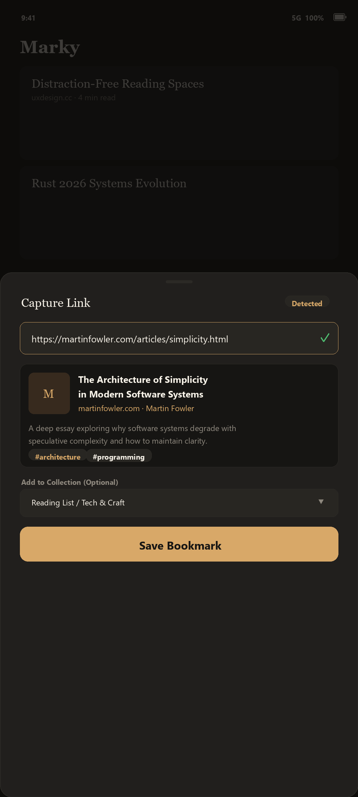

<div align="center">


# Marky

**Offline-First Personal Link Manager for Android**  
*Çevrimdışı öncelikli kişisel yer imi yöneticisi — bağlantılarını hızlı yakala, düzenle, hatırla.*

[](LICENSE)
[](https://flutter.dev)
[](https://dart.dev)
[-F6AB2F)](https://isar.dev)
[-3DDC84?logo=android&logoColor=white)](android)
[](CHANGELOG.md)
[](PRIVACY.md)

</div>

---

## Overview / Genel Bakış

**Marky** is an offline-first, privacy-respecting link manager and personal reading library built for Android with Flutter and the Isar local database. It captures web links from your browser or apps, enriches them with metadata, deduplicates them through an intelligent URL normalization engine, and lets you organize your reading life without ever syncing to a third-party cloud.

*Marky, bağlantılarını kaydetmek, düzenlemek ve gerektiğinde anında yeniden bulmak için tasarlanmış, çevrimdışı öncelikli bir Android uygulamasıdır. Yer imleri, etiketler, koleksiyonlar, notlar, hatırlatıcılar ve otomasyonlar tamamen cihazınızda yerel Isar veritabanı ile saklanır. Sunucu yoktur, verileriniz cihazınızdan çıkmaz.*

---

## 📚 Documentation / Dokümantasyon

Comprehensive documentation is organized under the [`docs/`](docs/) directory and project root:

- 🎨 **[Interface & System Design Specification](DESIGN.md):** Complete UI/UX design system (Reading Room tokens, palettes, typography, components) and end-to-end system design (Isar database schema, capture pipeline, scrapers, automation, and native Android integration).
- 🏛️ **[System Architecture Guide](docs/ARCHITECTURE.md):** Clean Architecture layers, Isar schema v1, URL intelligence pipeline, source scraper registry, automation engine, and native Android integration.
- 🧪 **[Testing & Verification Manual](docs/TESTING.md):** 500+ unit/widget test suite, native Android contract guards, PowerShell release gates, and Maestro human-like UI automation.
- 🗺️ **[Roadmap & Release Tracker](docs/ROADMAP.md):** Completed hardening milestones (Phases A through G1, J4) and pending Google Play release gates.
- 🛡️ **[Privacy Policy](PRIVACY.md):** Explicit statement on local storage, camera permissions, network usage, and zero third-party telemetry.
- 📜 **[Changelog](CHANGELOG.md):** Version history and verified release notes.

---

## ⚡ Core Features / Temel Özellikler

<table align="center">
  <tr>
    <td width="50%" align="left">
      <b>⚡ Instant Capture &amp; Share Overlay</b><br>
      Save links in a single tap via Android's share menu using a lightweight native transparent overlay window without switching away from your current app. Also supports clipboard detection, manual entry, and QR scanning.
    </td>
    <td width="50%" align="left">
      <b>🔁 Intelligent Deduplication</b><br>
      Duplicate links are detected via canonical URL matching, SHA-256 hashing, and external content IDs (YouTube, Reddit, GitHub). Existing bookmarks are surfaced with an instant <code>Open</code> action instead of cluttering your library.
    </td>
  </tr>
  <tr>
    <td width="50%" align="left">
      <b>📂 Collections &amp; Colored Tags</b><br>
      Organize links with flexible tags and custom color palettes. Group items into manual collections or dynamic smart collections based on source or tag criteria.
    </td>
    <td width="50%" align="left">
      <b>🔍 Structured Search Operators</b><br>
      Instant local search across titles, URLs, and notes. Power search with operators: <code>tag:flutter</code>, <code>domain:github.com</code>, <code>source:youtube</code>, <code>is:favorite</code>, <code>before:2026-01-01</code>.
    </td>
  </tr>
  <tr>
    <td width="50%" align="left">
      <b>🤖 Local Automation Rules</b><br>
      Automate post-capture workflows: auto-assign tags, archive read articles, move to specific collections, or trigger reminders based on matching domains or source types.
    </td>
    <td width="50%" align="left">
      <b>⏰ Reliable Notifications &amp; Reminders</b><br>
      Schedule exact alarm reminders for specific bookmarks or enable general unread link nudges. Powered by local Android exact alarms with reboot survival support.
    </td>
  </tr>
  <tr>
    <td width="50%" align="left">
      <b>📊 Library Analytics &amp; Insights</b><br>
      Visualize your reading habits, top domains, tag distribution, and weekly capture velocity entirely offline on your device.
    </td>
    <td width="50%" align="left">
      <b>💾 Backup, Restore &amp; HTML Export</b><br>
      Export your entire library into standardized JSON or browser-compatible Netscape HTML bookmarks. Restore backups with non-destructive duplicate merging.
    </td>
  </tr>
</table>

---

## 📱 Screenshots / Ekran Görüntüleri

<div align="center">

| Home Feed / Ana Ekran | Search & Operators / Arama | Library & Tags / Kütüphane |
|:---------------------:|:--------------------------:|:--------------------------:|
|  |  |  |

| Bookmark Detail / Detay | Quick Add / Hızlı Ekleme | Settings / Ayarlar |
|:-----------------------:|:------------------------:|:------------------:|
|  |  |  |

</div>

---

## 🛠️ Technology Stack

| Category | Technology & Libraries |
| :--- | :--- |
| **Framework & Language** | Flutter `>=3.22.0`, Dart `>=3.4.0 <4.0.0` |
| **Architecture** | Feature-First Clean Architecture, Riverpod 2.6, GoRouter 14.8 |
| **Database & Cache** | Embedded Isar Database v1 (local, offline-first), CachedNetworkImage |
| **URL & Scraping** | Dio, HTML Parser, Specialized parsers (Reddit, GitHub, Twitter, YouTube), Favicon API fallback |
| **Android Integration** | Android SDK 35/36, `FlutterFragmentActivity`, `ShareOverlayActivity`, AppWidget, Quick Shortcuts |
| **Security** | `local_auth` (Biometrics & Device Credentials), Android `FLAG_SECURE` |
| **Testing & CI** | `flutter_test`, `dart_test`, Maestro E2E UI Automation, PowerShell Quality Gates |

---

## 🚀 Getting Started / Başlangıç

### Prerequisites
- Flutter SDK `>=3.22.0`
- Dart SDK `>=3.4.0 <4.0.0`
- Android SDK 35 / 36 with Java 17
- Optional: [Maestro CLI](https://maestro.mobile.dev) for E2E automated UI testing

### Setup & Run
```bash
# 1. Clone the repository and fetch dependencies
flutter pub get

# 2. Run static analysis
flutter analyze

# 3. Run the full active test suite (516 tests)
flutter test

# 4. Launch the application in debug mode
flutter run
```

### Pre-Release Quality Gates
Marky includes automated PowerShell gate scripts to guarantee zero-regression builds:

```powershell
# Fast release check (formatting, analyze, focused tests, debug APK build)
.\scripts\pre_release_check.ps1

# Full release check with entire test suite
.\scripts\pre_release_check.ps1 -AllTests

# Run Maestro human-like UI smoke suite on device/emulator
.\scripts\run_maestro.ps1 -BuildApk -InstallApk

# Full production gate and release bundle generation
.\scripts\full_prod_gate.ps1 -BuildReleaseAppBundle
```

### Android Release Signing
Release builds require a local `android/key.properties` configuration or `MARKY_*` environment variables (`MARKY_STORE_FILE`, `MARKY_STORE_PASSWORD`, `MARKY_KEY_ALIAS`, `MARKY_KEY_PASSWORD`). Keystores and private signing credentials are never committed to version control.

---

## 📂 Project Structure / Proje Yapısı

```text
marky/
├── android/                 # Native Android layer (manifest, Kotlin activities, widgets, shortcuts)
├── assets/                  # App logo, launcher graphics, and Lottie animations
├── docs/                    # Centralized project documentation
│   ├── ARCHITECTURE.md      # Detailed system architecture, data models, and pipelines
│   ├── TESTING.md           # Testing guide, PowerShell gates, and Maestro automation
│   └── ROADMAP.md           # Production release tracking and forward horizons
├── lib/                     # Flutter application source code
│   ├── app/                 # Application bootstrap, routing, settings, and themes
│   ├── core/                # Database, scrapers, notifications, and URL intelligence
│   ├── features/            # Feature modules (Domain, Data, Presentation)
│   └── shared/              # Reusable UI components and error boundaries
├── marketing/               # Marketing assets and Remotion promo video generator
│   └── remotion/            # Code-generated launch video generator
├── screenshots/             # README and store preview screenshots
├── scripts/                 # PowerShell automated release gate scripts
├── test/                    # Production test suite (Unit, Widget, Contract, Smoke)
│   ├── app/                 # Localization and app shell tests
│   └── v2/                  # Modular feature, repository, and service tests
└── legacy_archive/          # Isolated legacy test files and refactoring tools
```

---

## 📄 License

Distributed under the [MIT License](LICENSE).  
Copyright © 2026 **Vyr0**.
