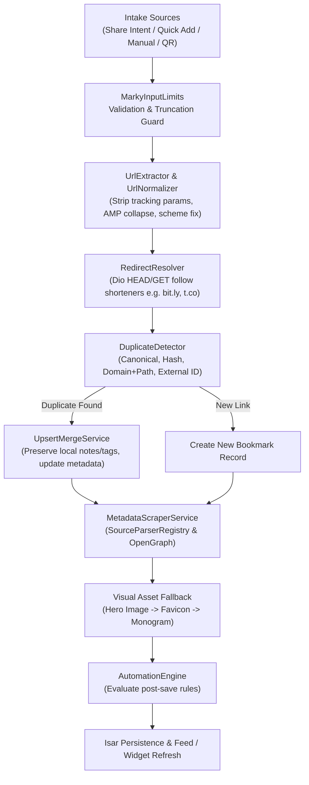

# Marky System Architecture & Design Specification

> **Version:** 1.0.0+1  
> **Status:** Production-Final Baseline  
> **Platform Target:** Android (SDK 35/36), Flutter 3.22+, Dart 3.4+

---

## 1. System Overview

Marky is an offline-first personal bookmark library and link manager designed for Android. It operates with zero mandatory cloud accounts, zero remote analytics or tracking SDKs, and stores 100% of bookmark data locally on the device using an embedded Isar database.

### 1.1 Core Principles

1. **Offline-First & Privacy-Focused:** All user bookmarks, tags, collections, notes, reminders, and automation rules reside locally on the device. Network requests are made strictly to resolve and scrape metadata from URLs saved by the user.
2. **Zero Technical Placeholders:** All modules are fully implemented with explicit error boundaries, input limits, and automated fallback behaviors.
3. **Robust URL Intelligence:** Links are sanitized, canonicalized, deduplicated, and resolved through shorteners before entering persistent storage.
4. **Reading Room Design Grammar:** An OLED pitch-black interface with high-contrast typography, restrained warm amber accents, and verified accessibility at large text scales.
5. **Native Android Synergy:** Deep platform integration with a floating share overlay activity, home screen app widget, launcher shortcuts, exact alarm reminders, and biometric security.

---

## 2. Clean Architecture Layering

The codebase follows Clean Architecture principles organized by features, strictly decoupling business logic from presentation and database implementations:

```text
lib/
├── app/                  # Application bootstrap, routing, settings, and themes
│   ├── routing/          # GoRouter configuration and route allowlists
│   ├── settings/         # App settings domain, repository, and providers
│   └── theme/            # Reading Room theme, tokens, and typography
├── core/                 # Shared domain engines, database, scraping, and utilities
│   ├── database/         # Isar database bootstrap, entities, enums, and schemas
│   ├── input/            # Input validation and bounding limits
│   ├── notifications/    # Local notification service interface and implementation
│   ├── scraping/         # Metadata scrapers, source parsers, and favicon/thumbnail services
│   ├── time/             # Timezone and datetime bootstrap
│   └── url/              # URL normalizer, redirect resolver, hasher, and extractors
├── features/             # Feature modules (Domain, Data, Presentation)
│   ├── add/              # Manual link intake, QR scanner, and quick add sheet
│   ├── automation/       # Automation rule engine, repository, and editor UI
│   ├── backup/           # Backup metadata tracking
│   ├── bookmarks/        # Core bookmark entity, queries, and repository
│   ├── capture/          # Capture orchestrator, upsert merge, and duplicate detection
│   ├── collections/      # Collections management and smart collection evaluator
│   ├── dashboard/        # Local archive analytics and distribution metrics
│   ├── detail/           # Bookmark detail view, inline editing, and action controls
│   ├── home/             # Primary feed, batch actions, and filter bar
│   ├── import_export/    # JSON / HTML import and export with duplicate protection
│   ├── library/          # Collection and tag management sheets
│   ├── notes/            # Per-bookmark notes domain and repository
│   ├── onboarding/       # First-launch onboarding experience
│   ├── quick_actions/    # Native shortcut route handling
│   ├── reminders/        # Notification-backed bookmark and unread reminder schedulers
│   ├── search/           # Tokenized search service with structured operators
│   ├── settings/         # User preferences screen
│   ├── share_intent/     # Android share overlay coordinator and bridge
│   ├── tags/             # Tag domain, repository, and assignment logic
│   └── widgets/          # Android AppWidget snapshot generator and service
└── shared/               # Cross-feature reusable widgets and utilities
    ├── errors/           # Release-safe technical error suppression
    └── widgets/          # Standardized Reading Room UI components
```

---

## 3. Data & Persistence Layer (Isar)

Persistence is handled by [Isar Database](file:///lib/core/database/marky_database.dart). All models are strongly typed with explicit schemas and isolated mappers.

### 3.1 Schemas & Collections

The database operates under **Schema Version 1**:

| Collection | Model / Entity | Responsibility |
| :--- | :--- | :--- |
| `BookmarkEntity` | `lib/core/database/entities/bookmark_entity.dart` | Primary bookmark records, URLs, scraped metadata, timestamps, tags, and status flags. |
| `TagEntity` | `lib/core/database/entities/tag_entity.dart` | User-defined organization tags with custom color swatches. |
| `CollectionEntity` | `lib/core/database/entities/collection_entity.dart` | Grouping containers supporting manual assignment and smart rule evaluation. |
| `NoteEntity` | `lib/core/database/entities/note_entity.dart` | Per-bookmark annotations with timestamps and edit history. |
| `ReminderEntity` | `lib/core/database/entities/reminder_entity.dart` | Scheduled notification triggers linked to bookmarks. |
| `SearchQueryEntity`| `lib/core/database/entities/search_query_entity.dart` | Recent and saved search query terms with timestamps. |
| `AutomationRuleEntity` | `lib/core/database/entities/automation_rule_entity.dart` | Trigger-action definitions for post-capture automation. |
| `BackupMetaEntity` | `lib/core/database/entities/backup_meta_entity.dart` | Local backup export logs and checksum metadata. |

### 3.2 Schema Invariant Enforcement
- `test/v2/core/database/marky_database_schema_test.dart` asserts that `schemaVersion == 1` and guarantees that collection schema registration order remains deterministic to prevent migration corruption.
- All domain transformations pass through bidirectional mappers (e.g. `BookmarkMapper`, `TagMapper`, `NoteMapper`) decoupling database entities from clean domain models.

---

## 4. Capture & URL Intelligence Pipeline

The capture engine is the central ingress of Marky. It accepts URLs from multiple intake vectors and processes them through a deterministic hygiene pipeline:



### 4.1 URL Normalization
- **Tracking Parameter Removal:** Strips common surveillance query parameters (`utm_*`, `ref`, `fbclid`, `gclid`, `mc_*`, `si`, `igshid`).
- **AMP Collapse:** Rewrites `/amp/` and `*.amp` endpoints into their canonical article sources.
- **Port & Format Safety:** Malformed ports or invalid URI schemes fail safely into `CaptureResult.invalidUrl` without throwing uncaught exceptions.

### 4.2 Duplicate Detection Engine
Duplicate detection executes a 4-tier check:
1. **Canonical URL Match:** Compares normalized canonical URLs.
2. **URL Hash Match:** Compares deterministic SHA-256 hashes generated by `UrlHasher`.
3. **Domain + Path Heuristics:** Matches base paths while ignoring trailing query discrepancies.
4. **External Content IDs:** Extracts platform-specific IDs (e.g., YouTube Video ID, Reddit Post ID, GitHub Repo Name) via `ExternalContentIdExtractor`.

---

## 5. Metadata Scraping & Source Parsers

Scraping is coordinated by `MetadataScraperService` using `SourceParserRegistry`:

### 5.1 Specialized Parsers
- **`GenericHtmlParser`:** Extracts OpenGraph (`og:title`, `og:image`, `og:description`), Twitter Card metadata, and standard HTML meta tags. It explicitly detects and filters out Cloudflare, captcha, and anti-bot challenge interstitial text.
- **`GitHubParser`:** Parses GitHub repo URLs and constructs structured titles, descriptions, owners, and repository OpenGraph preview cards.
- **`RedditParser`:** Parses Reddit post URLs using Reddit's public `.json` endpoint fallback (`/r/.../comments/...json?limit=1&raw_json=1`) to reliably retrieve post titles, subreddits, and high-resolution thumbnail media even when raw HTML is gated.
- **`TwitterParser`:** Extracts tweet status metadata, author handles, and attached media previews.
- **`YouTubeParser`:** Extracts video identifiers, title, channel name, and YouTube `maxresdefault`/`hqdefault` thumbnails.

### 5.2 Visual Fallback Hierarchy
1. High-resolution scraped hero image (`og:image` / parser media).
2. Domain favicon extracted by `FaviconService` via `Google Favicon API` fallback.
3. High-contrast vector monogram derived from domain name tokens.

---

## 6. Search & Filter Engine

Search is powered by `BookmarkSearchService` providing real-time local search:

### 6.1 Structured Search Operators
Users can query text freely or combine structured operators:
- `tag:<name>` — Filters by assigned tag (e.g., `tag:flutter`).
- `domain:<host>` — Filters by host domain (e.g., `domain:github.com`).
- `source:<type>` — Filters by detected source type (`source:youtube`, `source:reddit`, `source:github`, `source:article`).
- `is:favorite` / `is:archived` / `is:read` — Status filters.
- `before:<YYYY-MM-DD>` / `after:<YYYY-MM-DD>` — Date range bounds.

Query parsing is deterministic, with safe tokenization and query history persistence via `SearchQueryEntity`.

---

## 7. Automation Engine

Marky includes an in-app automation engine (`AutomationEngine`) that evaluates user-defined rules upon every bookmark capture:

- **Triggers (`AutomationTriggerType`):** Matches on Domain, Source Type, Content Type, or Tag match.
- **Actions (`AutomationActionType`):** Automatically applies tags, archives the bookmark, assigns it to a collection, or schedules an automated reading reminder.
- **Debug & Loop Protection:** Actions are non-recursive; executions are logged to `AutomationDebugLog` for in-app inspection.

---

## 8. Native Android Integration

Marky leverages deep Android system capabilities:

```text
android/app/src/main/
├── kotlin/com/marky/app/marky/
│   ├── MainActivity.kt                # FlutterFragmentActivity with OPEN_ROUTE allowlist
│   ├── ShareOverlayActivity.kt        # Lightweight transparent overlay activity
│   ├── ShareOverlayHost.kt            # Native lifecycle & Flutter engine coordinator
│   ├── ShareOverlayFlutterHost.kt     # MethodChannel bridge for share intent payloads
│   └── MarkyFeedWidgetProvider.kt     # AppWidgetProvider for home screen feed
└── res/
    ├── layout/marky_feed_widget.xml   # Native XML layout for Android widget
    ├── xml/shortcuts.xml              # Static launcher shortcuts (Add, Search, Unread, Reminders)
    └── xml/marky_feed_widget_info.xml # AppWidget metadata configuration
```

### 8.1 Floating Share Overlay
- Triggered by Android's global `ACTION_SEND` intent when sharing text or links from other apps (e.g., Chrome, Twitter, Reddit).
- Runs `ShareOverlayActivity` with a translucent dimming background (`Theme.Translucent.NoTitleBar`) and an independent lightweight Flutter engine instance running `ShareOverlayApp`.
- Captures and scrapes the link instantly without launching the main application window or disrupting the user's current foreground app.

### 8.2 Home Screen AppWidget
- `MarkyFeedWidgetProvider` renders the latest 3-5 saved bookmarks with titles, hosts, and timestamps directly on the Android home screen.
- Synchronized by `WidgetFeedSnapshotService` upon every bookmark mutation.

### 8.3 Route & Intent Security
- `MainActivity.kt` enforces an explicit `OPEN_ROUTE` allowlist (`/`, `/add`, `/search`, `/home`, `/reminders`).
- Arbitrary external deep links cannot force navigation into protected surfaces like Settings.

---

## 9. Security & Privacy

### 9.1 Release-Safe Error Boundary
- `safe_error_details.dart` filters out technical stack traces, local file system paths, and raw URL queries from release error messages.
- Production users see graceful, localized recovery dialogs with zero PII exposure.

---

## 10. Reading Room Design System

The application visual architecture is governed by `reading_room_theme.dart` and `reading_room_tokens.dart`:
- **Background:** True Pitch Black (`#000000`) for OLED power efficiency.
- **Surfaces:** Dark Charcoal (`#121212`, `#1E1E1E`) for elevated cards and bottom sheets.
- **Typography:** Warm Off-White Ink (`#E5E5E7`) and Muted Slate (`#8E8E93`).
- **Accent:** Warm Reading Amber (`#F6AB2F`) for interactive accents and status chips.
- **Accessibility:** Clamped text scaling (certified up to 2.0x text scaling) and strict `MediaQuery.disableAnimations` compliance for reduced-motion users.
