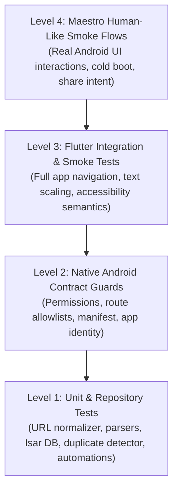

# Marky Verification & Testing Manual

> **Test Suite Status:** 516 / 516 passing (`flutter test`)  
> **Tooling Stack:** `flutter_test`, `dart_test`, Maestro E2E, PowerShell Automation  
> **Target Platform:** Android SDK 35/36, physical devices and emulators

---

## 1. Testing Philosophy & Verification Pyramid

Marky adheres to a multi-tiered testing strategy ensuring that unit logic, native Android contracts, UI rendering, and end-to-end user journeys are verified prior to any release build:



---

## 2. Unit & Widget Testing (`flutter_test`)

The active test suite contains over 500 unit, widget, and repository tests under `test/` and `test/v2/`.

### 2.1 Running Tests

Run the full production test suite:

```powershell
flutter test
```

Run tests with tag filtering (defined in `dart_test.yaml`):

```powershell
# Run only unit/widget tests excluding heavy Isar integration tests
flutter test --exclude-tags integration

# Run targeted Isar database tests
flutter test --tags integration
```

Run a specific test file:

```powershell
flutter test test/v2/app/v2_app_smoke_test.dart
```

### 2.2 Test Architecture & Fakes
- **In-Memory Isolation:** Widget smoke tests use lightweight stateful fakes (e.g., `BookmarkRepository`, `CaptureService`, `NotificationService`) avoiding unnecessary Isar file handles during UI testing.
- **Contract Verification:** Tests verify boundary guarantees such as URL input limits (`MarkyInputLimits`), schema versions, and parser fallback cascades.

---

## 3. Native Android Contract Guards

To prevent accidental regressions in native Android configurations, dedicated Dart tests inspect native Android source files directly:

| Test File | Verified Contract |
| :--- | :--- |
| `test/v2/app/android_manifest_permission_test.dart` | Ensures app requests only minimal permissions (`INTERNET`, `SCHEDULE_EXACT_ALARM`, `POST_NOTIFICATIONS`, `RECEIVE_BOOT_COMPLETED`), explicitly asserts `VIBRATE` is stripped via `tools:node="remove"`, and validates notification receivers. |
| `test/v2/app/android_route_whitelist_test.dart` | Confirms that `MainActivity.kt` and `QuickActionRoute` enforce the strict route allowlist (`/`, `/add`, `/search`, `/home`, `/reminders`) preventing external deep-link navigation into private or settings screens. |
| `test/v2/app/android_app_identity_test.dart` | Locks `applicationId`, app label, launcher icon, adaptive icon resources, and splash screen theme. |
| `test/v2/app/android_share_overlay_manifest_test.dart` | Validates that `ShareOverlayActivity` is configured with transparent theme, single-task launch mode, and appropriate intent filters. |

---

## 4. Release Gate Automation Scripts

Marky includes PowerShell automation scripts in `scripts/` to enforce quality gates before building release artifacts.

### 4.1 Fast Release Gate (`pre_release_check.ps1`)

Validates formatting, analyzer health, share-overlay widget tests, and builds a debug APK:

```powershell
# Fast gate (formatting + analyzer + focused tests + debug APK build)
.\scripts\pre_release_check.ps1

# Full test suite run
.\scripts\pre_release_check.ps1 -AllTests

# Static feedback only (skips APK compilation)
.\scripts\pre_release_check.ps1 -SkipBuild
```

### 4.2 Maestro Human-Like Smoke Suite (`run_maestro.ps1`)

Simulates real touch, swipe, keyboard, and share intent events on an active Android device or emulator:

```powershell
# Build debug APK, install on device, and run all Maestro flows
.\scripts\run_maestro.ps1 -BuildApk -InstallApk

# Run against an already-installed app
.\scripts\run_maestro.ps1

# Skip ADB-based share overlay test if running on limited emulator
.\scripts\run_maestro.ps1 -SkipShareOverlay
```

#### Maestro Flow Inventory (`.maestro/`):
- `01_onboarding.yaml`: Clears app data and verifies first-launch onboarding reaches the Home screen.
- `02_bottom_navigation.yaml`: Exercises the bottom navigation shell (Home, Search, Add, Library).
- `03_home_ui_stability.yaml`: Performs rapid feed scrolling and list/grid layout switching.
- `04_quick_add_sheet.yaml`: Opens the central quick-add bottom sheet and verifies intake options.
- `05_settings_automation.yaml`: Opens Automation Rules, navigates templates, and inspects guide sheets.
- `06_share_overlay.yaml`: Dispatches an Android `ACTION_SEND` intent via ADB and validates the floating overlay window.

### 4.3 Full Production Gate (`full_prod_gate.ps1`)

Executes the complete pipeline: static analysis, all tests, debug APK build, device install, Maestro E2E execution, and optional release App Bundle compilation:

```powershell
# Run complete verification gate
.\scripts\full_prod_gate.ps1

# Run complete gate and build release AAB upon success
.\scripts\full_prod_gate.ps1 -BuildReleaseAppBundle
```

---

## 5. Performance, Scale & Accessibility Verification

### 5.1 Cold-Start Profiling
Startup latency is measured on physical hardware (`SM G780G`, Android 13/API 33) using Flutter profile startup tracing:

```powershell
flutter run --profile --trace-startup -d <device-id>
```

**Baseline Metric:** `timeToFirstFrameMicros` clocked at **~408ms** (target: < 600ms).

### 5.2 Feed Scale Contracts
`home_feed_scale_test.dart` validates that the Home feed remains bounded and responsive across large datasets:
- Tested on empty, 100, 1,000, and 5,000 bookmark mock repositories.
- Guarantees default pagination (`limit: 100`, `offset: 0`) and validates lazy widget building so offscreen `BookmarkCard` instances are not materialized into memory prematurely.

### 5.3 Text Scale & Accessibility
`v2_app_smoke_test.dart` exercises Home, Search, Detail, Add, Library, Settings, and locked Vault under:
- **1.0x standard text scale**
- **1.5x accessibility scale**
- **2.0x large accessibility scale**
- **TalkBack verification:** Bookmark cards announce title, source, read status, and tags; search input has an explicit `InputDecoration.labelText` semantic announcement.
